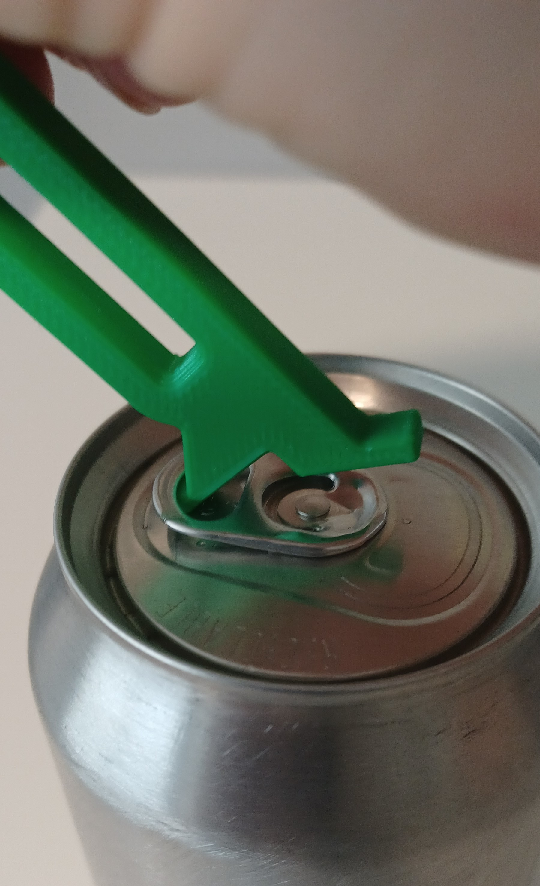

# Beverage Can Opener
The Beverage Can Opener provides an easy way for people with limited finger dexterity and strength to open pull tabs on a beverage can with little strength required. This design is only compatible with pull tabs with two holes.

This 3D printed tool is suitable for users with disabilities effecting the finger, such as arthritis, osteoarthritis, spinal cord injuries, Ehlers-Danos, among others.

## More info at
- [Makers Making Change Assistive Device Library Page](https://www.makersmakingchange.com/product/beverage-can-opener/01tJR000000690ZYAQ)

## How to Obtain a Beverage Can Opener
### 1. Do it Yourself (DIY) or Do it Together (DIT)

This is an open-source assistive technology, so anyone is free to build it. All of the files and instructions required to build the Beverage Can Opener are contained within this repository. Refer to the Maker Checklist below.

### 2. Request a build of this device

If you would like to obtain a Beverage Can Opener, you may submit a build request through the [MMC Library Page](https://www.makersmakingchange.com/product/beverage-can-opener/01tJR000000690ZYAQ). The requestor is responsible for the cost of materials and any shipping.

### 3. How to build this device for someone else

If you have the skills and equipment to build this device, and would like to donate your time to create the switch for someone who needs it, visit the [MMC Maker Wanted](https://makersmakingchange.com/maker-wanted/) section.

## Getting Started

### 1. Read the [Makers Checklist](/Documentation/Beverage_Can_Opener_Maker_Checklist_V1.0.pdf)

### 2. Print the Device

All of the print files can be in the [/Build_Files/3D_Print_Files](/Build_Files/3D_Print_Files/) folder.

Detailed instructions about 3D Printing settings can be found in the [3D Printing Guide](/Documentation/Beverage_Can_Opener_3D_Printing_Guide_V1.0.pdf).

## Files
### Documentation
| Document             | Version | Link |
|----------------------|---------|------|
| Design Rationale     | 1.0     | [Beverage_Can_Opener_Design_Rationale](/Documentation/Beverage_Can_Opener_Design_Rationale_V1.0.pdf)     |
| Maker Checklist      | 1.0     | [Beverage_Can_Opener_Maker_Checklist](/Documentation/Beverage_Can_Opener_Maker_Checklist_V1.0.pdf)     |
| Bill of Materials    | 1.0     | [Beverage_Can_Opener_Bill_of_Materials](/Documentation/Beverage_Can_Opener_BOM_V1.0.csv)     |
| 3D Printing Guide    | 1.0     | [Beverage_Can_Opener_3D_Printing_Guide](/Documentation/Beverage_Can_Opener_3D_Printing_Guide_V1.0.pdf)     |
| User Guide           | 1.0     | [Beverage_Can_Opener_User_Guide](/Documentation/Beverage_Can_Opener_User_Guide_V1.0.pdf)    |
| Changelog            | 1.0     | [Beverage_Can_Opener_Changelog](/Documentation/Beverage_Can_Opener_Changelog_V1.0.pdf)     |

### Design Files
[CAD Files](/Design_Files)

### Build Files
[3D Printing Files](/Build_Files/3D_Print_Files)

## Attribution
Original design by Jason Yeung of PrintLab used under a CC-BY-SA 4.0 License. More information about Printlab can be found on their website: https://weareprintlab.com/  

Minor modifications to design and documentation by Neil Squire / Makers Making Change.

## License
Copyright (c) 2024-2025 Neil Squire / Makers Making Change.

This repository describes Open Hardware:

 - Everything needed or used to design, make, test, or prepare the Beverage Can Opener is licensed under the CERN 2.0 Weakly Reciprocal license (CERN-OHL-W v2) or later .
 - Accompanying material such as instruction manuals, videos, and other copyrightable works that are useful but not necessary to design, make, test, or prepare the Beverage Can Opener are published under a Creative Commons Attribution-ShareAlike 4.0 license (CC BY-SA 4.0) .

You may redistribute and modify this documentation and make products using it under the terms of the CERN-OHL-W v2. This documentation is distributed WITHOUT ANY EXPRESS OR IMPLIED WARRANTY, INCLUDING OF MERCHANTABILITY, SATISFACTORY QUALITY AND FITNESS FOR A PARTICULAR PURPOSE. Please see the CERN-OHL-W v2 for applicable conditions.

Source Location: https://github.com/makersmakingchange/Beverage_Can_Opener

---
<!-- ABOUT MMC START -->
## About Makers Making Change

Makers Making Change is a program of [Neil Squire](https://www.neilsquire.ca/), a Canadian non-profit that uses technology, knowledge, and passion to empower people with disabilities.

Makers Making Change leverages the capacity of community based Makers, Disability Professionals and Volunteers to develop and deliver affordable Open Source Assistive Technologies.

 - Website: [www.MakersMakingChange.com](https://www.makersmakingchange.com/)
 - GitHub: [makersmakingchange](https://github.com/makersmakingchange)
 - Bluesky: [@makersmakingchange.bsky.social](https://bsky.app/profile/makersmakingchange.bsky.social)
 - Instagram: [@makersmakingchange](https://www.instagram.com/makersmakingchange)
 - Facebook: [makersmakechange](https://www.facebook.com/makersmakechange)
 - LinkedIn: [Neil Squire Society](https://www.linkedin.com/company/neil-squire-society/)
 - Thingiverse: [makersmakingchange](https://www.thingiverse.com/makersmakingchange/about)
 - Printables: [MakersMakingChange](https://www.printables.com/@MakersMakingChange)

### Contact Us
For technical questions, to get involved, or to share your experience we encourage you to [visit our website](https://www.makersmakingchange.com/) or [contact us](https://www.makersmakingchange.com/s/contact).
<!-- ABOUT MMC END -->
